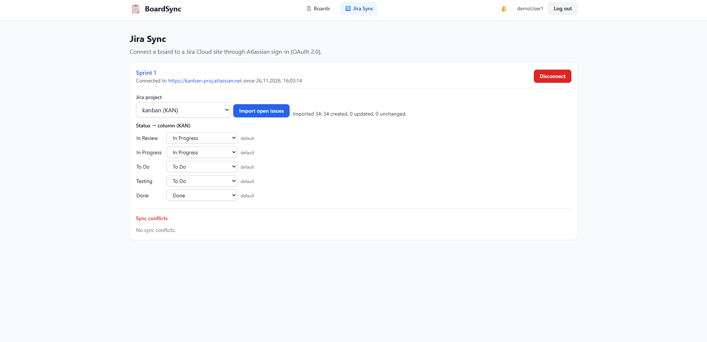

# BoardSync — Frontend

[](https://github.com/inryceu/3-course-sd-lifecycle-fe/actions/workflows/ci.yml?query=branch%3Adev)
[](https://github.com/inryceu/3-course-sd-lifecycle-fe/actions/workflows/ci.yml?query=branch%3Amain)

> Kanban board UI with two-way Jira synchronization. Frontend repository (React + TypeScript).

## Concept

BoardSync gives teams a fast, visual kanban board that stays in sync with Jira automatically, so no one has to update a card's status twice. This repository implements the client: the drag-and-drop board, real-time updates, and the Jira-connection UI.

## Approach

- **Spec-driven development.** UI features are implemented against the agreed requirements/API spec, not ad hoc (see the project's *Специфікація вимог* document).
- **Modular structure.** Feature-based folders (`auth/`, `boards/`, `cards/`, `jira-sync/`, plus the `realtime` hook; see `docs/architecture/frontend-structure.md`), each with its own components and hooks, mirroring the backend's module boundaries.
- **Real-time first.** The board subscribes to a WebSocket channel so every connected user sees cards created, edited and moved, and board changes, without a page reload.

## Project Structure

```
src/
├── App.tsx, main.tsx    # routes, providers
├── api/                 # client.ts, endpoints.ts, schema.ts, token-storage.ts, api.generated.ts
├── components/          # ConfirmButton, auth/ProtectedRoute, layout/Layout
├── features/
│   ├── auth/            # LoginPage, RegisterPage, AuthContext, validation
│   ├── boards/          # BoardsPage, BoardPage, BoardHeader, ColumnView, MembersPanel,
│   │                    #   move-card.ts (drag & drop positions), use-members.ts
│   ├── cards/           # CardDialog
│   └── jira-sync/       # JiraSyncPage, JiraImportPanel, JiraCallbackPage (OAuth callback)
└── hooks/               # useWebSocket (realtime)
```

## Key features

| Area | What it covers |
| --- | --- |
| Boards & columns | Create/edit boards and columns, drag-and-drop cards, board members and roles |
| Cards | Create/edit cards, deadline, assignee; labels and comments are planned (KAN-42) |
| Jira connection | OAuth 2.0 flow, connect/disconnect a Jira site, import open issues, status → column mapping |
| Realtime | Live board updates via WebSocket |
| Auth | Login/registration, role-based UI (Admin / Member / Viewer) |

## Tech stack

| Layer | Technology | Version |
| --- | --- | --- |
| Language | TypeScript | 5.3+ |
| Framework | React | 18+ |
| Build Tool | Vite | 5+ |
| Server state | TanStack Query | 5+ |
| Routing | React Router | 6+ |
| Styling | Tailwind CSS | 3+ |
| Real-time | Socket.IO Client | 4+ |
| Testing | Vitest | 1+ |
| Runtime | Node.js | 20+ |
| Package Manager | pnpm | 9+ |
| Containerization | Docker / Docker Compose | — |
| CI/CD | GitHub Actions (workflow in `.github/workflows/ci.yml`) | — |

## Team

| Name | Role | Modules |
| --- | --- | --- |
| Pavlo | PM + Fullstack developer — boards & cards module | `src/features/boards/`, `src/features/cards/` |
| Edward | Fullstack developer — Jira integration module | `src/features/jira-sync/` |
| Denys | Fullstack developer — auth & users module | `src/features/auth/` |
| Kyrylo | Fullstack developer — realtime module, DevOps/CI-CD | `src/hooks/useWebSocket.ts`, CI/CD, nginx |

## Getting started

### Prerequisites

| Tool | Version | Source |
|------|---------|--------|
| Node.js | >=20.0.0 | `package.json:engines.node` (both repos) |
| pnpm | 9.0.0 | `package.json:packageManager` (both repos) |
| Docker | — | Required for compose stacks |
| Docker Compose | — | Required for compose stacks |

### Environment setup (local dev)

```bash
# install dependencies
pnpm install

# copy env template (Vite reads VITE_* at build/serve time)
cp .env.example .env.local
# edit .env.local if your backend runs on a different host/port
```

### Run modes

#### 1. Frontend-only dev (Vite HMR)

```bash
pnpm dev
# Vite at http://localhost:5173
# Proxies /api and /socket.io to http://localhost:3000 (configured in vite.config.ts)
```

#### 2. Integrated dev stack (this repo's `docker-compose.yml`)

```bash
docker compose up --build
```

| Service | URL | Notes |
|---------|-----|-------|
| Frontend (Vite) | http://localhost:5173 | HMR enabled |
| Backend (NestJS dev) | http://localhost:3000 | `pnpm start:dev` inside container |
| Backend WebSocket | http://localhost:3001 | Socket.IO on separate port (dev only) |
| Postgres | localhost:5432 | `postgres`/`postgres`/`boardsync_dev` |

> Uses `../3-course-sd-lifecycle-be/.env.dev` for backend env. Network `boardsync-dev-network` is `external: true` — create once: `docker network create boardsync-dev-network`.

#### 3. Production-like full stack (backend repo's `docker-compose.full.yml`)

Both repos checked out side-by-side (`../3-course-sd-lifecycle-be` and `../3-course-sd-lifecycle-fe`):

```bash
cd ../3-course-sd-lifecycle-be
cp .env.full.example .env.full   # fill in ALL secrets (no defaults)
docker compose --env-file .env.full -f docker-compose.full.yml up --build
```

| Service | URL | Notes |
|---------|-----|-------|
| Web UI (nginx + frontend) | http://localhost:8080 | `WEB_PORT` override in `.env.full` |
| REST API | http://localhost:8080/api/v1 | Proxied to backend |
| WebSocket | http://localhost:8080/socket.io/ | Namespace `/realtime` |
| Swagger UI | http://localhost:8080/api/v1/docs | Served by backend |
| Backend direct (debug) | http://127.0.0.1:3000/api/v1 | `BACKEND_PORT` override in `.env.full` |

> Backend runs production image with `NODE_ENV=development` (HTTPS redirect disabled for local OAuth callbacks; see T-39). Set `FRONTEND_CONTEXT` in `.env.full` if frontend is not at `../3-course-sd-lifecycle-fe`.

#### 4. Production stack (this repo's `docker-compose.prod.yml`)

```bash
docker compose -f docker-compose.prod.yml up --build
```

| Service | URL | Notes |
|---------|-----|-------|
| Frontend (nginx) | http://localhost:80 | Port 80 bound to 127.0.0.1 |
| Backend | http://127.0.0.1:3000 | Not exposed publicly |
| Postgres | 127.0.0.1:5432 | Password via Docker secret |

> Requires `../3-course-sd-lifecycle-be/.env.prod` (all `${VAR}` must be set in environment/CI). Network `boardsync-prod-network` is `external: true`. Secrets: `../3-course-sd-lifecycle-be/secrets/db_password.txt`. **TLS termination (T-39) is NOT implemented** — nginx listens on 80 only; 443 port declared but no SSL config present.

### Verification commands

```bash
# Frontend checks
pnpm lint && pnpm typecheck && pnpm test && pnpm build

# Backend checks (run in backend repo)
pnpm lint && pnpm typecheck && pnpm test && pnpm build
```

---

### Environment variable reference

| Name | Repo/Service | Required | Default | Description |
|------|--------------|----------|---------|-------------|
| `VITE_API_URL` | Frontend (build) | Yes | `http://localhost:3000/api/v1` | REST base URL. Docker image built with `/api/v1` (same-origin behind nginx). |
| `VITE_WS_URL` | Frontend (build) | No | (empty = page origin) | Socket.IO origin; client connects to `<origin>/realtime`. Empty = same origin. |
| `NODE_ENV` | Backend | Yes | — | `development` \| `production` \| `test`. Affects HTTPS redirect, cookie secure flag. |
| `PORT` | Backend | No | `3000` | HTTP port (Socket.IO shares it). |
| `API_PREFIX` | Backend | No | `api/v1` | Route prefix for all endpoints. |
| `FRONTEND_URL` | Backend | Yes | — | CORS origin (must be a valid URI). |
| `TRUST_PROXY` | Backend | No | `0` | Number of reverse proxies (nginx = 1); makes `req.ip` the real client for rate limits. |
| `RATE_LIMIT_PER_MINUTE` | Backend | No | `100` | Global rate limit per client per minute. |
| `RATE_LIMIT_REGISTER` | Backend | No | `5` | Register rate limit per client per 5 minutes. |
| `RATE_LIMIT_LOGIN` | Backend | No | `10` | Login rate limit per client per 5 minutes. |
| `DATABASE_HOST` | Backend | Yes | — | Postgres host (hostname). |
| `DATABASE_PORT` | Backend | No | `5432` | Postgres port. |
| `DATABASE_USERNAME` | Backend | Yes | — | Postgres user. |
| `DATABASE_PASSWORD` | Backend | Yes | — | Postgres password. |
| `DATABASE_NAME` | Backend | Yes | — | Postgres database. |
| `DATABASE_LOGGING` | Backend | No | `false` | Log SQL queries (`true`/`false`). |
| `DATABASE_POOL_MAX` | Backend | No | `10` | Connection pool size. |
| `JWT_SECRET` | Backend | Yes | — | HS256 secret, ≥32 chars (`openssl rand -base64 48`). No placeholder in production. |
| `JWT_EXPIRES_IN` | Backend | No | `1h` | Access token TTL (≤1h). Format: `<n><s\|m\|h>`. |
| `BCRYPT_ROUNDS` | Backend | No | `10` | Cost factor (10–15, NFR-SEC-4: at least 10). |
| `JIRA_CLIENT_ID` | Backend | Yes | — | Atlassian OAuth 2.0 (3LO) client ID. |
| `JIRA_CLIENT_SECRET` | Backend | Yes | — | Atlassian OAuth 2.0 (3LO) client secret. |
| `JIRA_REDIRECT_URI` | Backend | Yes | — | Must match registered callback (HTTPS in production). |
| `JIRA_SCOPES` | Backend | No | `read:jira-work,write:jira-work,read:jira-user,manage:jira-webhook,offline_access` | Comma-separated scopes. |
| `JIRA_WEBHOOK_URL` | Backend | No | — | Public receiver for dynamic webhook (HTTPS in production). |
| `JIRA_AUTH_BASE_URL` | Backend | No | `https://auth.atlassian.com` | Atlassian auth endpoint (HTTPS in production). |
| `JIRA_API_BASE_URL` | Backend | No | `https://api.atlassian.com` | Atlassian API endpoint (HTTPS in production). |
| `TOKEN_ENCRYPTION_KEY` | Backend | Yes | — | AES-256-GCM key, 64 hex chars (`openssl rand -hex 32`). |
| `WEBHOOK_SECRET` | Backend | Yes | — | Jira webhook verification secret, ≥32 chars. |
| `REMINDER_INTERVAL_SECONDS` | Backend | No | `60` | Deadline reminder scheduler interval; `0` = off. |
| `REALTIME_PING_INTERVAL_MS` | Backend | No | `25000` | Socket.IO ping interval (ms). |
| `REALTIME_PING_TIMEOUT_MS` | Backend | No | `20000` | Socket.IO ping timeout (ms). |
| `WEB_PORT` | Compose (full) | No | `8080` | Host port for nginx frontend. |
| `BACKEND_PORT` | Compose (full) | No | `3000` | Host port for backend direct access. |
| `FRONTEND_CONTEXT` | Compose (full) | No | `../3-course-sd-lifecycle-fe` | Path to frontend repo for build context. |
| `FRONTEND_IMAGE` | Compose (full) | No | `boardsync-frontend:full` | Prebuilt frontend image (use with `--no-build`). |
| `DATABASE_PASSWORD` | Compose (full/prod) | Yes | — | Postgres password (shared backend+db). |
| `JWT_SECRET` | Compose (full/prod) | Yes | — | Backend JWT secret. |
| `TOKEN_ENCRYPTION_KEY` | Compose (full/prod) | Yes | — | Backend token encryption key. |
| `WEBHOOK_SECRET` | Compose (full/prod) | Yes | — | Backend webhook secret. |
| `JIRA_CLIENT_ID` | Compose (full/prod) | Yes | — | Atlassian OAuth client ID. |
| `JIRA_CLIENT_SECRET` | Compose (full/prod) | Yes | — | Atlassian OAuth client secret. |
| `RATE_LIMIT_PER_MINUTE` | Compose (full) | No | `100` | Override backend rate limit (per minute). |
| `RATE_LIMIT_REGISTER` | Compose (full) | No | `5` | Override register rate limit (per 5 min). |
| `RATE_LIMIT_LOGIN` | Compose (full) | No | `10` | Override login rate limit (per 5 min). |

> Notes:
> - Backend `Required` = validated by `src/config/validation.schema.ts` (no default). `Default` = schema default.
> - `JIRA_REDIRECT_URI` is **not** a compose variable; `docker-compose.full.yml` derives it from `WEB_PORT`.
> - `JIRA_WEBHOOK_URL` is **not** used by `docker-compose.full.yml`; it appears in `.env.full.example` as a production reference only.
> - Compose `Required` = compose fails with a clear message if missing (`${VAR:?message}`).

---

### Health check URLs

| Stack | Frontend | Backend | Database |
|-------|----------|---------|----------|
| FE `docker-compose.yml` (dev) | — (Vite) | `http://localhost:3000/api/v1/health` | `docker exec boardsync-postgres-dev pg_isready -U postgres -d boardsync_dev` |
| BE `docker-compose.full.yml` | `http://localhost:8080/health` (nginx) | `http://127.0.0.1:3000/api/v1/health` | Internal (compose healthcheck) |
| FE `docker-compose.prod.yml` | `http://localhost/health` (nginx) | `http://127.0.0.1:3000/api/v1/health` | Internal (compose healthcheck) |

**Backend health response** (`HealthStatus`):
```json
{ "status": "ok", "database": "connected", "timestamp": "2026-...Z" }
```
Returns 200 if DB reachable, 503 otherwise (`@SkipThrottle()`, `@Public()`).

---

### API documentation & specifications

- **Swagger UI (OpenAPI 3.0)**: `http://localhost:8080/api/v1/docs` (on `docker-compose.full.yml` stack)
- **OpenAPI YAML**: `../3-course-sd-lifecycle-be/docs/api/openapi.yaml`
- **WebSocket events**: `../3-course-sd-lifecycle-be/docs/api/ws-events.md`
- **OpenSpec specs (single source of truth)**: `../3-course-sd-lifecycle-be/openspec/specs/`
  - List: `openspec list --specs --json` (run in backend repo)
  - Active changes: `openspec list --json` (run in backend repo)

### System tests (Playwright)

`e2e/` holds browser tests of the core journeys: register → log in, create a board → add cards →
drag a card, and a board Viewer's restrictions. They run against a running full stack (above) and
seed their own users and boards through the API (`pw-<unique>@example.com`), so any stack works.
Vitest never picks them up (it only collects `src/`).

```bash
pnpm exec playwright install chromium firefox msedge   # once
PLAYWRIGHT_BASE_URL=http://localhost:8080 pnpm e2e                     # all browsers
PLAYWRIGHT_BASE_URL=http://localhost:8080 pnpm e2e --project=chromium  # one browser
```

A failed test leaves its trace and screenshot in `test-results/`
(`pnpm exec playwright show-trace test-results/<test>/trace.zip`).

Projects: `setup` (registers a user and stores its session in `e2e/.auth/`), then `chromium`,
`firefox` and `msedge` (Edge channel). Fixtures live in `e2e/fixtures.ts`: `seed` (API seeding),
`signIn(page, token)` and `signedInTest` (starts with the stored session).

CI: `.github/workflows/e2e.yml` checks out the backend next to this repository (the PR's target
branch), starts `docker-compose.full.yml` with the placeholder `.env.full.example`, runs the suite in
all three browsers and always uploads `playwright-report/` and `test-results/` (traces,
screenshots) as the `playwright-report` artifact.

### Performance and compatibility (T-54)

`e2e/performance.spec.ts` covers NFR-PERF-1, NFR-UI-1 and NFR-COMP-1:

- **Load time.** Seeds 100 cards into one column (sequentially, so card positions do not race),
  then times `page.goto` of the board until the last card is visible. Budget: 2000 ms. The test runs
  in its own serial describe with `retries: 0`, so a slow run is never hidden by a retry. Each run
  records `board-load-ms` as a test annotation and a `performance.json` attachment (visible in the
  HTML report and in `playwright-report/`).
- **Layout.** A separate test checks that the board page has no horizontal overflow at 1280 x 720.
  It does not depend on the timing test.

Measured, Chromium (Playwright 1.65.0 bundled build), headless, 1280 x 720, local full stack
(Docker Compose: web + backend + Postgres on the same Windows 11 laptop, 16 logical CPUs, nothing else
running in the browser), fresh user and board per run, 5 consecutive runs: 210, 228, 234, 240 and
417 ms (budget 2000 ms). Firefox and Edge were not run for these figures; they run in CI, where the
numbers appear in each run's HTML report. CI timings on a shared 2-core runner are expected to be
slower than the figures above; the 2000 ms budget is the pass criterion, not these numbers.

**Browser matrix.** CI runs the latest stable Chromium, Firefox and Microsoft Edge (`chromium`,
`firefox`, `msedge` projects; the Playwright version in `pnpm-lock.yaml` pins the first two, `msedge`
uses the Edge that `playwright install msedge` installs, always the current stable). The "latest two
versions" criterion is met for the current version only; the previous release is an accepted
deviation for the course project because Playwright installs a single build per browser and a
second matrix row would double the CI time. To check the previous release by hand, run the suite
with the older `@playwright/test` release that bundled it (the release notes list the browser
versions of each release): `pnpm dlx @playwright/test@<version> install chromium firefox` and then
`pnpm dlx @playwright/test@<version> test`. The next release can be tried with the `msedge-beta` /
`chrome-beta` channels (`use: { channel: 'msedge-beta' }` in a local config).

## Environment variables

| Variable | Default | Meaning |
| --- | --- | --- |
| `VITE_API_URL` | `http://localhost:3000/api/v1` | REST base URL. The Docker image is built with `/api/v1` (same origin). |
| `VITE_WS_URL` | page origin | Origin of the Socket.IO server; the client connects to `<origin>/realtime`. Empty = same origin. |

Values are read at build time (`import.meta.env`). See `.env.example`.

## API contract and generated types

The contract lives in the backend repository (`docs/api/openapi.yaml`, `docs/api/ws-events.md`).
This repo keeps a synced copy and generated types:

```bash
pnpm api:sync       # copy the spec from ../3-course-sd-lifecycle-be (override with BACKEND_REPO=...)
pnpm api:generate   # docs/api/openapi.yaml -> src/api/api.generated.ts (deterministic)
```

CI regenerates the types and fails if `src/api/api.generated.ts` is out of date.

## Specifications and diagrams

- **Backend OpenSpec specs** (single source of truth): `../3-course-sd-lifecycle-be/openspec/specs/`
  - List specs: `openspec list --specs --json` (run in backend repo)
  - Active changes: `openspec list --json` (run in backend repo)
- **PlantUML diagrams** (source): `docs/declarative/`
  - Component diagram: `01-component.puml`
  - Class diagram: `02-class.puml`
  - Jira sync sequence: `03-sequence-jira-sync.puml`
  - OAuth sequence: `05-sequence-oauth.puml`
  - Realtime sequence: `06-sequence-realtime.puml`
  - State diagram: `04-state.puml`
- **Rendered diagrams** (PNG): `docs/image/`
- **Frontend architecture doc**: `docs/architecture/frontend-structure.md`

## Branch & PR workflow

Short summary; [`CONTRIBUTING.md`](CONTRIBUTING.md) is the authority and wins if the two differ.

- **Branch naming**: `KAN-<n>` (from `dev`), one branch per Jira ticket
- **Conflict resolution**: create `KAN-<n>-dev` branch from `dev`, resolve conflicts, open PR `KAN-<n>-dev` → `dev`
- **Merge flow**: PR into `dev` → squash merge → `dev` → `main` at sprint end
- **Commits**: Conventional Commits (`feat:`, `fix:`, `docs:`, `refactor:`, `test:`, `chore:`)
- **PR requirements** (per `CONTRIBUTING.md`): CI green (Lint, TypeCheck, Tests, Build, Docker Build), 1 approval, conversations resolved
- **AI agents**: may open/comment/edit PRs, **never merge**
- **Details**: `CONTRIBUTING.md`, `AGENTS.md#git-workflow-rules`

## User guide

This guide covers the features currently implemented in BoardSync. Each section describes what the user does, the expected result, and the relevant UI route/component. Specifications are cited from `../3-course-sd-lifecycle-be/openspec/specs/`.

### Connecting Jira

**What the user does:**  
A board Admin navigates to **Jira Sync** (top navigation), clicks **Connect Jira** next to a board, and completes the Atlassian OAuth 2.0 (3LO) authorization flow with PKCE and anti-CSRF state. After granting consent, they are redirected back to the Jira Sync page where the connected Jira site URL is displayed. The Admin can later disconnect Jira, which removes the stored credentials.

**Expected result:**  
- The board shows "Connected to <site-url> since <timestamp>"  
- The **Import open issues** form and **Status → column** mapping table become available  
- Only the board Admin can connect/disconnect; Members and Viewers see "Only the board Admin can change the connection"

**UI route / component:**  
- Route: `/jira-sync` → `src/features/jira-sync/JiraSyncPage.tsx`  
- OAuth callback: `/jira/callback` → `src/features/jira-sync/JiraCallbackPage.tsx`  
- Import panel: `src/features/jira-sync/JiraImportPanel.tsx`

**Spec:** `../3-course-sd-lifecycle-be/openspec/specs/jira-oauth-connection/spec.md` (FR-02)  
**Spec:** `../3-course-sd-lifecycle-be/openspec/specs/jira-issue-import/spec.md` (FR-05, T-24)



---

### Boards

**What the user does:**  
On the **Boards** page (`/boards`), any authenticated user can create a new board by entering a title and clicking **Create board**. The creator becomes the board Admin. The board starts with three default columns: **To Do**, **In Progress**, **Done**. On a board page (`/boards/:boardId`), the Admin can add columns (**Add column**), rename columns (click **Edit**), change column types (TODO / IN_PROGRESS / REVIEW / DONE), reorder columns (←/→ buttons), and delete columns (with confirmation). Non-Admin members see the board but cannot modify structure. Viewers see the board read-only.

**Expected result:**  
- New board appears in the list with the creator as Admin  
- Default columns created atomically with the board  
- Admin actions update the board in real-time for all connected members  
- Minimum 3 columns enforced; non-empty columns cannot be deleted

**UI route / component:**  
- Boards list: `/boards` → `src/features/boards/BoardsPage.tsx`  
- Board page: `/boards/:boardId` → `src/features/boards/BoardPage.tsx`  
- Column view: `src/features/boards/ColumnView.tsx`  
- Members panel: `src/features/boards/MembersPanel.tsx`

**Spec:** `../3-course-sd-lifecycle-be/openspec/specs/boards-columns/spec.md` (FR-03, FR-04)  
**Spec:** `../3-course-sd-lifecycle-be/openspec/specs/board-members/spec.md` (FR-12)


---

### Cards

**What the user does:**  
On any column, Members and Admins click **Add a card**, enter a title, and click **Add**. Clicking a card opens the **Card dialog** where the user can edit:
- **Title** (required)
- **Description** (optional, up to 10,000 chars)
- **Column** (dropdown to move between columns)
- **Assignee** (dropdown of board members; can be cleared)
- **Deadline** (date picker; ISO-8601 UTC stored)
- **Labels** (attach/detach board labels)
- **Comments** (add, view, delete own comments; Admin can delete any)

Dragging a card to another column or position moves it instantly with optimistic UI update. Admins and Members can delete cards (with confirmation).

**Expected result:**  
- Card created at the bottom of the target column  
- All edits persist and broadcast `card.updated` / `card.moved` events  
- Real-time updates appear on all connected clients without reload  
- Viewers cannot create, edit, move, or delete cards (403)  
- Assignee must be a board member; clearing assignee is allowed

**UI route / component:**  
- Column view (add card): `src/features/boards/ColumnView.tsx`  
- Card dialog: `src/features/cards/CardDialog.tsx`  
- Card move logic: `src/features/boards/move-card.ts`

**Spec:** `../3-course-sd-lifecycle-be/openspec/specs/boards-columns/spec.md` (FR-03, FR-04 — card access, moves, assignment)


---

### Labels

**What the user does:**  
In the **Card dialog**, the **Labels** section shows attached labels as colored pills. Members and Admins click **+ Add** to open a popover where they can:
- **Create a new label**: enter name, pick color (defaults to `#3498db`), click **Create** → label is created on the board and attached to the card
- **Attach existing label**: click a label button (toggles attachment)
- **Edit a label**: click **Edit** on any board label → rename and/or recolor → **Save**
- **Delete a label**: click **Delete** on any board label (removes from all cards on the board)

Viewers see labels read-only.

**Expected result:**  
- Label names are unique per board (trimmed, case-insensitive; 409 on duplicate)  
- Colors are hex values; default `#3498db`  
- Attaching/detaching publishes `card.updated`  
- Creating/renaming/deleting labels publishes `board.updated`  
- Label from another board cannot be attached (404)

**UI route / component:**  
- Card dialog → Labels section: `src/features/cards/CardLabels.tsx`

**Spec:** `../3-course-sd-lifecycle-be/openspec/specs/labels-comments/spec.md` (Board labels, Labels on cards)


---

### Deadlines

**What the user does:**  
In the **Card dialog**, the user sets a **Deadline** via the date picker. The deadline is stored as UTC ISO-8601. In the column view, cards with deadlines show:
- **Due date** (localized)
- **"Due soon"** badge (yellow) if deadline is within 24 hours and column is not **Done**
- **"Overdue"** badge (red) if deadline has passed and column is not **Done**

A background scheduler runs every 60 seconds (`REMINDER_INTERVAL_SECONDS`). For each card assigned to a user with a deadline within the next 24 hours that hasn't been reminded yet, it creates an in-app notification of type `deadline.reminder` with the card title, board ID, and deadline. The notification appears in the **Notifications bell** (🔔) in the header and is pushed in real-time via `notification.created` to the user's personal room.

**Expected result:**  
- Deadline displayed in user's locale  
- Badges update every minute without server round-trip  
- Exactly one reminder per (card, assignee, deadline) — idempotent across restarts and concurrent runs  
- Changing deadline or assignee allows a new reminder  
- Notifications are private (404 if another user tries to access)  
- Marking read persists `readAt`; unread count shown on bell

**UI route / component:**  
- Card dialog deadline field: `src/features/cards/CardDialog.tsx` (lines 276-288)  
- Column view badges: `src/features/boards/ColumnView.tsx` (lines 96-116)  
- Notifications bell: `src/features/notifications/NotificationsBell.tsx`  
- Scheduler (backend): `REMINDER_INTERVAL_SECONDS` env var

**Spec:** `../3-course-sd-lifecycle-be/openspec/specs/deadline-reminders/spec.md` (FR-09)


---

### Comments

**What the user does:**  
In the **Card dialog**, the **Comments** section loads comments oldest-first with cursor pagination (**Load more comments**). Members and Admins can:
- **Add a comment**: type in the textarea, click **Add comment** → appears instantly (optimistic), then confirmed by server
- **Delete a comment**: click **Delete** on own comment (or any comment if Admin) → removed immediately
- See **"• Jira"** badge on comments synced from Jira

Comments are ordered by `(createdAt, id)`; paging uses opaque cursors that survive deletions. A user removed from the board cannot list or delete their old comments (404).

**Expected result:**  
- New comment appears at the bottom with author name ("You" for current user) and timestamp  
- Pagination loads older comments without duplicates  
- Deleted comments disappear from all clients in real-time (`card.commented` event)  
- Author or Admin can delete; removed members get 404 on list/delete but comment remains

**UI route / component:**  
- Card dialog → Comments section: `src/features/cards/CardComments.tsx`

**Spec:** `../3-course-sd-lifecycle-be/openspec/specs/labels-comments/spec.md` (Comments and their access, Comment paging)  
**Spec:** `../3-course-sd-lifecycle-be/openspec/specs/event-bus/spec.md` (`card.commented` event)


---

### Real-time updates

**What the user does:**  
No action required — real-time is automatic. When any connected user:
- Creates, edits, moves, or deletes a card
- Adds/removes a column
- Adds/removes a label
- Adds/deletes a comment
- Changes board membership

…the change appears instantly on all other connected clients viewing the same board, without page reload. The **Notifications bell** also receives `notification.created` events (deadline reminders, Jira sync conflicts) pushed to the user's personal room.

**Expected result:**  
- All clients in `board:{boardId}` room receive `card.created`, `card.updated`, `card.moved`, `card.commented`, `board.updated`  
- Originating socket (with `X-Socket-Id` header) does not receive its own event  
- Removed members receive `member.removed` and are evicted from the board room  
- Heartbeat: ping every 25s, timeout 20s — unresponsive clients disconnected  
- Authenticated handshake required; room access validated on join

**UI route / component:**  
- WebSocket hook: `src/hooks/useWebSocket.ts`  
- Board page subscription: `src/features/boards/BoardPage.tsx` (lines 29-90)  
- Notifications bell subscription: `src/features/notifications/NotificationsBell.tsx` (lines 50-68)

**Spec:** `../3-course-sd-lifecycle-be/openspec/specs/event-bus/spec.md` (Realtime delivery, Authenticated handshake, Heartbeat)


---

## FR/NFR Compliance

This table maps every requirement ID from `../3-course-sd-lifecycle-be/openspec/specs/` to its implementation status and evidence. ✅ = fully implemented and tested; ⚠️ = partially implemented or missing a piece; ❌ = not implemented.

| ID | Requirement (short) | Spec | Status | Evidence |
|----|---------------------|------|--------|----------|
| FR-01 | Registration & login (email/password, JWT, rate limits) | [user-auth](https://github.com/inryceu/3-course-sd-lifecycle-be/blob/main/openspec/specs/user-auth/spec.md) | ✅ Met | `src/modules/auth/` (presentation, application), `src/features/auth/`, `test/auth.e2e-spec.ts` |
| FR-02 | Jira OAuth 2.0 (3LO) connect/disconnect/status, PKCE, state | [jira-oauth-connection](https://github.com/inryceu/3-course-sd-lifecycle-be/blob/main/openspec/specs/jira-oauth-connection/spec.md) | ✅ Met | `src/modules/jira-sync/application/jira-oauth.service.ts`, `src/features/jira-sync/JiraSyncPage.tsx`, `JiraCallbackPage.tsx` |
| FR-03, FR-04 | Boards, columns, cards with role-based permissions | [boards-columns](https://github.com/inryceu/3-course-sd-lifecycle-be/blob/main/openspec/specs/boards-columns/spec.md) | ✅ Met | `src/modules/boards/`, `src/features/boards/`, `test/boards-cards.e2e-spec.ts` |
| FR-05 | Jira project link, status→column mapping, idempotent import | [jira-issue-import](https://github.com/inryceu/3-course-sd-lifecycle-be/blob/main/openspec/specs/jira-issue-import/spec.md) | ✅ Met | `src/modules/jira-sync/application/jira-import.service.ts`, `src/features/jira-sync/JiraImportPanel.tsx` |
| FR-06 | Board→Jira status sync (≤5 s, one transition, sync log, conflict check) | [jira-status-sync](https://github.com/inryceu/3-course-sd-lifecycle-be/blob/main/openspec/specs/jira-status-sync/spec.md) | ⚠️ Partial | `src/modules/jira-sync/application/jira-status-sync.service.ts` — **gap**: no outbox/retry for failed writes (T-35/T-49); no user-facing failure surface (T-34/T-35); needs OpenSpec change (BE) |
| FR-07 | Jira→Board status sync via webhook (≤5 s, dedup, watermark, HTTPS required) | [jira-webhook-sync](https://github.com/inryceu/3-course-sd-lifecycle-be/blob/main/openspec/specs/jira-webhook-sync/spec.md) | ⚠️ Partial | `src/modules/jira-sync/application/jira-webhook.service.ts` — **gap**: production HTTPS webhook URL not available locally (T-39); needs OpenSpec change (BE) |
| FR-08 | Board labels (CRUD, unique name, default color) & card comments (paging, author/Admin delete) | [labels-comments](https://github.com/inryceu/3-course-sd-lifecycle-be/blob/main/openspec/specs/labels-comments/spec.md) | ✅ Met | `src/modules/boards/`, `src/features/cards/CardLabels.tsx`, `CardComments.tsx` |
| FR-09 | 24-h deadline reminders (idempotent scheduler, notifications, realtime push) | [deadline-reminders](https://github.com/inryceu/3-course-sd-lifecycle-be/blob/main/openspec/specs/deadline-reminders/spec.md) | ✅ Met | `src/modules/boards/`, `src/features/notifications/NotificationsBell.tsx`, `REMINDER_INTERVAL_SECONDS` env |
| FR-10 | Comment mirroring to Jira (ADF, synced flag, sync log, 5 s budget) | [jira-comment-sync](https://github.com/inryceu/3-course-sd-lifecycle-be/blob/main/openspec/specs/jira-comment-sync/spec.md) | ⚠️ Partial | `src/modules/jira-sync/application/jira-comment-sync.service.ts` — **gap**: no outbox/retry for failed writes (T-35/T-49); needs OpenSpec change (BE) |
| FR-11 | Real-time updates (Socket.IO rooms, auth handshake, heartbeat, member removal) | [event-bus](https://github.com/inryceu/3-course-sd-lifecycle-be/blob/main/openspec/specs/event-bus/spec.md) | ✅ Met | `src/modules/realtime/`, `src/hooks/useWebSocket.ts`, `src/features/boards/BoardPage.tsx` |
| FR-12 | Board members (invite by email, roles, last-Admin protection) | [board-members](https://github.com/inryceu/3-course-sd-lifecycle-be/blob/main/openspec/specs/board-members/spec.md) | ✅ Met | `src/modules/boards/`, `src/features/boards/MembersPanel.tsx` |
| FR-13 | Sync conflict detection/logging/admin notification/resolution | [jira-sync-conflicts](https://github.com/inryceu/3-course-sd-lifecycle-be/blob/main/openspec/specs/jira-sync-conflicts/spec.md) | ⚠️ Partial | `src/modules/jira-sync/application/jira-sync-conflicts.service.ts`, `src/features/jira-sync/JiraConflictsPanel.tsx` — **gap**: UI shows conflicts but cannot resolve them; needs OpenSpec change (BE) |
| NFR-SEC-2 | Jira tokens encrypted at rest (AES-256-GCM), never in logs/responses | [jira-token-vault](https://github.com/inryceu/3-course-sd-lifecycle-be/blob/main/openspec/specs/jira-token-vault/spec.md) | ✅ Met | `src/modules/jira-sync/infrastructure/aes-gcm-token-cipher.ts`, `src/common/logger/sanitizing-logger.service.ts` |
| NFR-SEC-3 | TLS/HTTPS for production OAuth redirect & webhook receiver | [jira-oauth-connection](https://github.com/inryceu/3-course-sd-lifecycle-be/blob/main/openspec/specs/jira-oauth-connection/spec.md) | ❌ Not met | `docker-compose.prod.yml` declares port 443 but `nginx/conf.d` has **no SSL config**; `./ssl` dir NOT FOUND; needs OpenSpec change (BE) |
| NFR-SEC-4 | Bcrypt cost factor ≥10 (configurable) | [app-configuration](https://github.com/inryceu/3-course-sd-lifecycle-be/blob/main/openspec/specs/app-configuration/spec.md) | ✅ Met | `src/config/validation.schema.ts` validates `BCRYPT_ROUNDS` ≥10; default 10 in `.env.example` |
| NFR-PERF-1 | 5-second budget for all Jira outbound calls (status sync, webhook, comment sync) | [jira-status-sync](https://github.com/inryceu/3-course-sd-lifecycle-be/blob/main/openspec/specs/jira-status-sync/spec.md), [jira-webhook-sync](https://github.com/inryceu/3-course-sd-lifecycle-be/blob/main/openspec/specs/jira-webhook-sync/spec.md), [jira-comment-sync](https://github.com/inryceu/3-course-sd-lifecycle-be/blob/main/openspec/specs/jira-comment-sync/spec.md) | ✅ Met | `SYNC_BUDGET_MS = 5000` in `jira-status-sync.service.ts`, `jira-webhook.service.ts`, `jira-comment-sync.service.ts` |

---

### Known limitations

The following features are specified but **not yet implemented** in the frontend:

- **Two-way Jira status sync** — Moving a card in BoardSync does not update the Jira issue status (KAN-36, T-25, T-26). Import is one-way only.
- **Jira webhook delivery** — Jira changes do not appear on the board via webhook (KAN-37). Webhook endpoint exists but sync is not wired.
- **Jira comment sync** — Comments added in Jira are not imported; comments added in BoardSync are not pushed to Jira (KAN-42).
- **Jira conflict resolution UI** — `JiraConflictsPanel` exists but the conflict resolution flow (FR-13) is backend-only; UI shows conflicts but cannot resolve them.
- **Board description editing** — Boards have a `description` field (shown on Boards list) but no UI to edit it.
- **Column type `REVIEW`** — Defined in schema but no special behavior; treated as a regular column type.
- **Markdown in descriptions/comments** — Stored as plain text; no rendering.

For the authoritative list of planned work, see `../3-course-sd-lifecycle-be/openspec/changes/`.

## Related

- Backend repository: [`3-course-sd-lifecycle-be`](https://github.com/inryceu/3-course-sd-lifecycle-be)
- Requirements specification: `Специфікація_вимог_BoardSync.md`
