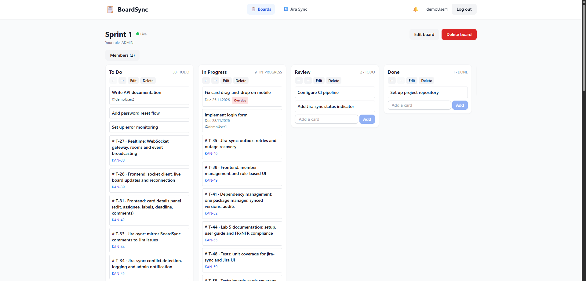
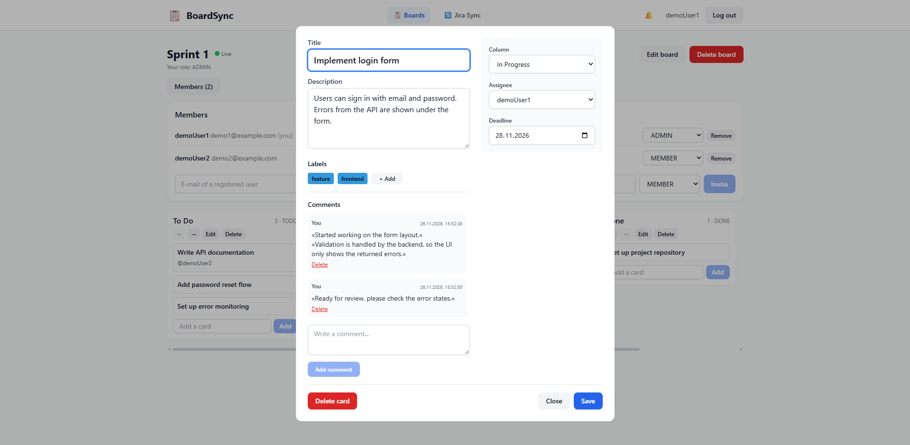
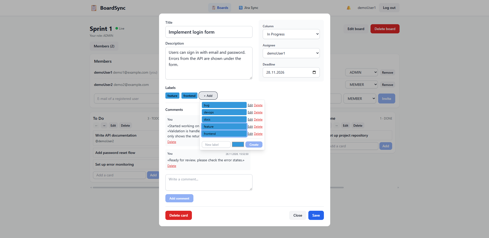
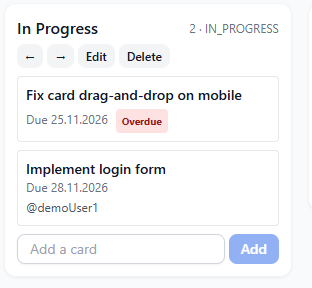
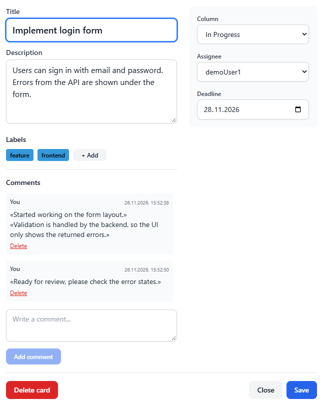
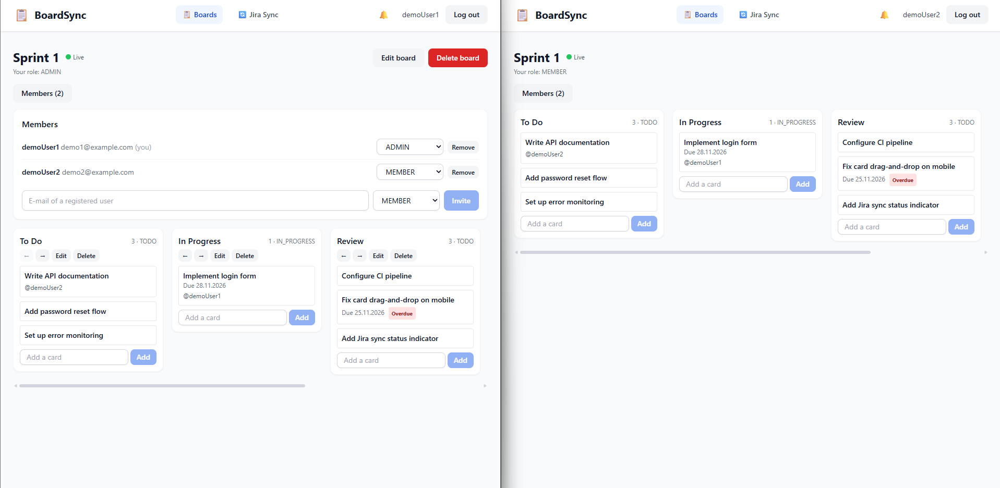

# BoardSync — Frontend

[](https://github.com/inryceu/3-course-sd-lifecycle-fe/actions/workflows/ci.yml?query=branch%3Adev)
[](https://github.com/inryceu/3-course-sd-lifecycle-fe/actions/workflows/ci.yml?query=branch%3Amain)

> Kanban board UI with two-way Jira synchronization. Frontend repository (React + TypeScript).

## Concept

BoardSync gives teams a fast, visual kanban board that stays in sync with Jira automatically, so no one has to update a card's status twice. This repository implements the client: the drag-and-drop board, real-time updates, and the Jira-connection UI.

## Approach

- **Spec-driven development.** UI features are implemented against the agreed requirements/API spec, not ad hoc (see the project's *Специфікація вимог* document).
- **Modular structure.** Feature-based folders (`auth/`, `boards/`, `cards/`, `jira-sync/`, plus the `realtime` hook; see `docs/architecture/frontend-structure.md`), each with its own components and hooks, mirroring the backend's module boundaries.
- **Real-time first.** The board subscribes to a WebSocket channel so every connected user sees cards created, edited and moved, and board changes, without a page reload.

## Project Structure

```
src/
├── App.tsx, main.tsx    # routes, providers
├── api/                 # client.ts, endpoints.ts, schema.ts, token-storage.ts, api.generated.ts
├── components/          # ConfirmButton, auth/ProtectedRoute, layout/Layout
├── features/
│   ├── auth/            # LoginPage, RegisterPage, AuthContext, validation
│   ├── boards/          # BoardsPage, BoardPage, BoardHeader, ColumnView, MembersPanel,
│   │                    #   move-card.ts (drag & drop positions), use-members.ts
│   ├── cards/           # CardDialog
│   └── jira-sync/       # JiraSyncPage, JiraImportPanel, JiraCallbackPage (OAuth callback)
└── hooks/               # useWebSocket (realtime)
```

## Key features

| Area | What it covers |
| --- | --- |
| Boards & columns | Create/edit boards and columns, drag-and-drop cards, board members and roles |
| Cards | Create/edit cards, deadline, assignee; labels, comments and deadline badges |
| Jira connection | OAuth 2.0 flow, connect/disconnect a Jira site, import open issues, status → column mapping |
| Realtime | Live board updates via WebSocket |
| Auth | Login/registration, role-based UI (Admin / Member / Viewer) |

## Tech stack

| Layer | Technology | Version |
| --- | --- | --- |
| Language | TypeScript | 5.3+ |
| Framework | React | 18+ |
| Build Tool | Vite | 5+ |
| Server state | TanStack Query | 5+ |
| Routing | React Router | 6+ |
| Styling | Tailwind CSS | 3+ |
| Real-time | Socket.IO Client | 4+ |
| Testing | Vitest | 1+ |
| Runtime | Node.js | 22 LTS (`.nvmrc`) |
| Package Manager | pnpm | 9 (`packageManager`) |
| Containerization | Docker / Docker Compose | — |
| CI/CD | GitHub Actions (workflow in `.github/workflows/ci.yml`) | — |

## Team

| Name | Role | Modules |
| --- | --- | --- |
| Pavlo | PM + Fullstack developer — boards & cards module | `src/features/boards/`, `src/features/cards/` |
| Edward | Fullstack developer — Jira integration module | `src/features/jira-sync/` |
| Denys | Fullstack developer — auth & users module | `src/features/auth/` |
| Kyrylo | Fullstack developer — realtime module, DevOps/CI-CD | `src/hooks/useWebSocket.ts`, CI/CD, nginx |

## Getting started

### Prerequisites

| Tool | Version | Source |
|------|---------|--------|
| Node.js | >=20.0.0 | `package.json:engines.node` (both repos) |
| pnpm | 9.0.0 | `package.json:packageManager` (both repos) |
| Docker | — | Required for compose stacks |
| Docker Compose | — | Required for compose stacks |

### Environment setup (local dev)

```bash
# install dependencies (pnpm 9, Node 22 LTS: `nvm use`)
pnpm install

# copy env template (Vite reads VITE_* at build/serve time)
cp .env.example .env.local
# edit .env.local if your backend runs on a different host/port
```

### Run modes

#### 1. Frontend-only dev (Vite HMR)

```bash
pnpm dev
# Vite at http://localhost:5173
# Proxies /api and /socket.io to http://localhost:3000 (configured in vite.config.ts)
# Needs a backend on :3000: `pnpm start:dev` in the backend repo (see its README), or use the full stack below
```

#### 2. Full stack (backend repo's `docker-compose.full.yml`)

Both repos checked out side-by-side (`../3-course-sd-lifecycle-be` and `../3-course-sd-lifecycle-fe`):

```bash
cd ../3-course-sd-lifecycle-be
cp .env.full.example .env.full   # fill in ALL secrets (no defaults)
docker compose --env-file .env.full -f docker-compose.full.yml up --build
```

| Service | URL | Notes |
|---------|-----|-------|
| Web UI (nginx + frontend) | http://localhost:8080 | `WEB_PORT` override in `.env.full` |
| REST API | http://localhost:8080/api/v1 | Proxied to backend |
| WebSocket | http://localhost:8080/socket.io/ | Namespace `/realtime` |
| Swagger UI | http://localhost:8080/api/v1/docs | Served by backend |
| Backend direct (debug) | http://127.0.0.1:3000/api/v1 | `BACKEND_PORT` override in `.env.full` |

> Backend runs production image with `NODE_ENV=development` (HTTPS redirect disabled for local OAuth callbacks; see T-39). Set `FRONTEND_CONTEXT` in `.env.full` if frontend is not at `../3-course-sd-lifecycle-fe`.

**Making "Connect Jira" work.** The placeholder values in `.env.full.example` are enough to start the stack, but connecting Jira needs a real Atlassian OAuth 2.0 (3LO) app: put its `JIRA_CLIENT_ID` and `JIRA_CLIENT_SECRET` into `.env.full`, and register `http://localhost:<WEB_PORT>/jira/callback` as the app's callback URL (it must equal the derived `JIRA_REDIRECT_URI`). Without it the first user-guide step ends in an OAuth error. The app, scopes and who may authorise it are described in the backend's [`docs/jira-sandbox.md`](https://github.com/inryceu/3-course-sd-lifecycle-be/blob/dev/docs/jira-sandbox.md).

#### 3. Production-like stack with TLS (backend repo's `docker-compose.prod.yml`)

Run from `../3-course-sd-lifecycle-be`. The profile starts postgres, the backend and an nginx that terminates TLS (1.2 and 1.3 only), redirects HTTP to HTTPS and proxies REST and Socket.IO (`wss://`). Only nginx publishes ports; the backend applies migrations before it starts listening.

```bash
./nginx/generate-self-signed-cert.sh                 # self-signed cert into ssl/ (local use only)
mkdir -p secrets && printf '%s' "$DATABASE_PASSWORD" > secrets/db_password.txt   # must equal DATABASE_PASSWORD
export FRONTEND_URL=https://localhost DATABASE_PASSWORD=... JWT_SECRET=... \
       JIRA_CLIENT_ID=... JIRA_CLIENT_SECRET=... JIRA_REDIRECT_URI=https://localhost/jira/callback \
       JIRA_WEBHOOK_URL=https://localhost/api/v1/jira/webhook TOKEN_ENCRYPTION_KEY=... WEBHOOK_SECRET=...
docker compose -f docker-compose.prod.yml up -d --wait
```

| What | URL |
|------|-----|
| REST API | https://localhost/api/v1 (HTTP on port 80 redirects here) |
| Socket.IO | wss://localhost/realtime |
| Liveness / readiness | https://localhost/api/v1/health/alive, https://localhost/api/v1/health/ready |

`ssl/` and `secrets/` are git-ignored, which is why a fresh checkout has no `ssl/` until the script runs. With `NODE_ENV=production` the backend refuses to start unless `FRONTEND_URL`, `JIRA_REDIRECT_URI` and `JIRA_WEBHOOK_URL` are `https://` URLs. `HTTP_PORT` / `HTTPS_PORT` move nginx off 80/443. The self-signed certificate makes browsers and curl complain (`curl -k`). This profile serves no web client (nginx proxies `/` to the backend too); use the full stack above for the UI. Protocol, redirect, header and probe checks with their commands: [`docs/tls-verification.md`](https://github.com/inryceu/3-course-sd-lifecycle-be/blob/dev/docs/tls-verification.md).


### Verification commands

```bash
# Frontend checks
pnpm lint && pnpm typecheck && pnpm test && pnpm build

# Backend checks (run in backend repo)
pnpm lint && pnpm typecheck && pnpm test && pnpm build
```

---

### Environment variable reference

| Name | Repo/Service | Required | Default | Description |
|------|--------------|----------|---------|-------------|
| `VITE_API_URL` | Frontend (build) | Yes | `http://localhost:3000/api/v1` | REST base URL. Docker image built with `/api/v1` (same-origin behind nginx). |
| `VITE_WS_URL` | Frontend (build) | No | (empty = page origin) | Socket.IO origin; client connects to `<origin>/realtime`. Empty = same origin. |
| `NODE_ENV` | Backend | Yes | — | `development` \| `production` \| `test`. Affects HTTPS redirect, cookie secure flag. |
| `PORT` | Backend | No | `3000` | HTTP port (Socket.IO shares it). |
| `API_PREFIX` | Backend | No | `api/v1` | Route prefix for all endpoints. |
| `FRONTEND_URL` | Backend | Yes | — | CORS origin (must be a valid URI). |
| `TRUST_PROXY` | Backend | No | `0` | Number of reverse proxies (nginx = 1); makes `req.ip` the real client for rate limits. |
| `RATE_LIMIT_PER_MINUTE` | Backend | No | `100` | Global rate limit per client per minute. |
| `RATE_LIMIT_REGISTER` | Backend | No | `5` | Register rate limit per client per 5 minutes. |
| `RATE_LIMIT_LOGIN` | Backend | No | `10` | Login rate limit per client per 5 minutes. |
| `DATABASE_HOST` | Backend | Yes | — | Postgres host (hostname). |
| `DATABASE_PORT` | Backend | No | `5432` | Postgres port. |
| `DATABASE_USERNAME` | Backend | Yes | — | Postgres user. |
| `DATABASE_PASSWORD` | Backend | Yes | — | Postgres password. |
| `DATABASE_NAME` | Backend | Yes | — | Postgres database. |
| `DATABASE_LOGGING` | Backend | No | `false` | Log SQL queries (`true`/`false`). |
| `DATABASE_POOL_MAX` | Backend | No | `10` | Connection pool size. |
| `JWT_SECRET` | Backend | Yes | — | HS256 secret, ≥32 chars (`openssl rand -base64 48`). No placeholder in production. |
| `JWT_EXPIRES_IN` | Backend | No | `1h` | Access token TTL (≤1h). Format: `<n><s\|m\|h>`. |
| `BCRYPT_ROUNDS` | Backend | No | `10` | Cost factor (10–15, NFR-SEC-4: at least 10). |
| `JIRA_CLIENT_ID` | Backend | Yes | — | Atlassian OAuth 2.0 (3LO) client ID. |
| `JIRA_CLIENT_SECRET` | Backend | Yes | — | Atlassian OAuth 2.0 (3LO) client secret. |
| `JIRA_REDIRECT_URI` | Backend | Yes | — | Must match registered callback (HTTPS in production). |
| `JIRA_SCOPES` | Backend | No | `read:jira-work,write:jira-work,read:jira-user,manage:jira-webhook,offline_access` | Comma-separated scopes. |
| `JIRA_WEBHOOK_URL` | Backend | No | — | Public receiver for dynamic webhook (HTTPS in production). |
| `JIRA_AUTH_BASE_URL` | Backend | No | `https://auth.atlassian.com` | Atlassian auth endpoint (HTTPS in production). |
| `JIRA_API_BASE_URL` | Backend | No | `https://api.atlassian.com` | Atlassian API endpoint (HTTPS in production). |
| `TOKEN_ENCRYPTION_KEY` | Backend | Yes | — | AES-256-GCM key, 64 hex chars (`openssl rand -hex 32`). |
| `WEBHOOK_SECRET` | Backend | Yes | — | Jira webhook verification secret, ≥32 chars. |
| `REMINDER_INTERVAL_SECONDS` | Backend | No | `60` | Deadline reminder scheduler interval; `0` = off. |
| `REALTIME_PING_INTERVAL_MS` | Backend | No | `25000` | Socket.IO ping interval (ms). |
| `REALTIME_PING_TIMEOUT_MS` | Backend | No | `20000` | Socket.IO ping timeout (ms). |
| `WEB_PORT` | Compose (full) | No | `8080` | Host port for nginx frontend. |
| `BACKEND_PORT` | Compose (full) | No | `3000` | Host port for backend direct access. |
| `FRONTEND_CONTEXT` | Compose (full) | No | `../3-course-sd-lifecycle-fe` | Path to frontend repo for build context. |
| `FRONTEND_IMAGE` | Compose (full) | No | `boardsync-frontend:full` | Prebuilt frontend image (use with `--no-build`). |
| `HTTP_PORT` / `HTTPS_PORT` | Compose (prod profile) | No | `80` / `443` | Host ports of the TLS nginx. |


> Notes:
> - Backend `Required` = validated by `src/config/validation.schema.ts` (no default). `Default` = schema default.
> - `JIRA_REDIRECT_URI` is **not** a compose variable; `docker-compose.full.yml` derives it from `WEB_PORT`.
> - `JIRA_WEBHOOK_URL` is **not** used by `docker-compose.full.yml`; it appears in `.env.full.example` as a production reference only.
> - Compose `Required` = compose fails with a clear message if missing (`${VAR:?message}`).

---

### Health check URLs

| Stack | Frontend | Backend | Database |
|-------|----------|---------|----------|
| BE `docker-compose.full.yml` | `http://localhost:8080/health` (nginx) | `http://127.0.0.1:3000/api/v1/health` | Internal (compose healthcheck) |
| BE `docker-compose.prod.yml` | — (no web client) | `https://localhost/api/v1/health/alive`, `/ready` (nginx, `curl -k`) | Internal (compose healthcheck) |

The backend has three probes:

| Path under `/api/v1` | Checks | Response |
|----------------------|--------|----------|
| `/health` | process and database | 200 `{"status":"ok","database":"up","timestamp":"...","uptime":123.4}`, 503 `{"status":"error","database":"down",...}` |
| `/health/alive` | liveness, process only (no database) | 200 `{"status":"ok","timestamp":"...","uptime":123.4}` |
| `/health/ready` | readiness, database reachable | same as `/health` |

All three are public and exempt from rate limiting. The production profile's healthchecks use `/alive` for nginx and `/ready` for the backend.

---


### API documentation & specifications

- **Swagger UI (OpenAPI 3.0)**: `http://localhost:8080/api/v1/docs` (on `docker-compose.full.yml` stack)
- **OpenAPI YAML**: `../3-course-sd-lifecycle-be/docs/api/openapi.yaml`
- **WebSocket events**: `../3-course-sd-lifecycle-be/docs/api/ws-events.md`
- **OpenSpec specs (single source of truth)**: `../3-course-sd-lifecycle-be/openspec/specs/`
  - List: `openspec list --specs --json` (run in backend repo)
  - Active changes: `openspec list --json` (run in backend repo)

### System tests (Playwright)

`e2e/` holds browser tests of the core journeys: register → log in, create a board → add cards →
drag a card, and a board Viewer's restrictions. They run against a running full stack (above) and
seed their own users and boards through the API (`pw-<unique>@example.com`), so any stack works.
Vitest never picks them up (it only collects `src/`).

```bash
pnpm exec playwright install chromium firefox msedge   # once
PLAYWRIGHT_BASE_URL=http://localhost:8080 pnpm e2e                     # all browsers
PLAYWRIGHT_BASE_URL=http://localhost:8080 pnpm e2e --project=chromium  # one browser
```

A failed test leaves its trace and screenshot in `test-results/`
(`pnpm exec playwright show-trace test-results/<test>/trace.zip`).

Projects: `setup` (registers a user and stores its session in `e2e/.auth/`), then `chromium`,
`firefox` and `msedge` (Edge channel). Fixtures live in `e2e/fixtures.ts`: `seed` (API seeding),
`signIn(page, token)` and `signedInTest` (starts with the stored session).

CI: `.github/workflows/e2e.yml` checks out the backend next to this repository (the PR's target
branch), starts `docker-compose.full.yml` with the placeholder `.env.full.example`, runs the suite in
all three browsers and always uploads `playwright-report/` and `test-results/` (traces,
screenshots) as the `playwright-report` artifact.

### Performance and compatibility (T-54)

`e2e/performance.spec.ts` covers NFR-PERF-1, NFR-UI-1 and NFR-COMP-1:

- **Load time.** Seeds 100 cards into one column (sequentially, so card positions do not race),
  then times `page.goto` of the board until the last card is visible. Budget: 2000 ms. The test runs
  in its own serial describe with `retries: 0`, so a slow run is never hidden by a retry. Each run
  records `board-load-ms` as a test annotation and a `performance.json` attachment (visible in the
  HTML report and in `playwright-report/`).
- **Layout.** A separate test checks that the board page has no horizontal overflow at 1280 x 720.
  It does not depend on the timing test.

Measured, Chromium (Playwright 1.65.0 bundled build), headless, 1280 x 720, local full stack
(Docker Compose: web + backend + Postgres on the same Windows 11 laptop, 16 logical CPUs, nothing else
running in the browser), fresh user and board per run, 5 consecutive runs: 210, 228, 234, 240 and
417 ms (budget 2000 ms). Firefox and Edge were not run for these figures; they run in CI, where the
numbers appear in each run's HTML report. CI timings on a shared 2-core runner are expected to be
slower than the figures above; the 2000 ms budget is the pass criterion, not these numbers.

**Browser matrix.** CI runs the latest stable Chromium, Firefox and Microsoft Edge (`chromium`,
`firefox`, `msedge` projects; the Playwright version in `pnpm-lock.yaml` pins the first two, `msedge`
uses the Edge that `playwright install msedge` installs, always the current stable). The "latest two
versions" criterion is met for the current version only; the previous release is an accepted
deviation for the course project because Playwright installs a single build per browser and a
second matrix row would double the CI time. To check the previous release by hand, run the suite
with the older `@playwright/test` release that bundled it (the release notes list the browser
versions of each release): `pnpm dlx @playwright/test@<version> install chromium firefox` and then
`pnpm dlx @playwright/test@<version> test`. The next release can be tried with the `msedge-beta` /
`chrome-beta` channels (`use: { channel: 'msedge-beta' }` in a local config).

## Dependencies

- **pnpm only** (`packageManager` in `package.json`, enabled through corepack). Never run `npm install` or `yarn`; commit only `pnpm-lock.yaml`. CI and Docker use `pnpm install --frozen-lockfile`.
- **Node 22 LTS**: `.nvmrc` is the single source (`nvm use`); `engines` is `>=22 <23`, CI reads `.nvmrc` and the Dockerfile uses `node:22-alpine`. Moving to another Node major means changing all of them in one PR (and in the backend repo).
- **Dependabot** (`.github/dependabot.yml`) opens monthly PRs: minor/patch updates grouped into production and development PRs, major versions ignored (upgrade them deliberately), Docker `node` majors ignored. Review them like any PR; nothing is auto-merged. `src/api/api.generated.ts` is never edited by hand.
- **Audit policy**: the `Dependency Audit` job runs `pnpm audit --audit-level=critical` on every push/PR and weekly; it is a required check (`pnpm audit` locally runs the same command). `package.json` carries one override, `tinypool@^2.1.2`, for a critical advisory in vitest 3's test runner (vitest 4+ needs Vite 6+); drop it with the next vitest major.


## API contract and generated types

The contract lives in the backend repository (`docs/api/openapi.yaml`, `docs/api/ws-events.md`).
This repo keeps a synced copy and generated types:

```bash
pnpm api:sync       # copy the spec from ../3-course-sd-lifecycle-be (override with BACKEND_REPO=...)
pnpm api:generate   # docs/api/openapi.yaml -> src/api/api.generated.ts (deterministic)
```

CI regenerates the types and fails if `src/api/api.generated.ts` is out of date.

## Diagrams

- **PlantUML diagrams** (source): `docs/declarative/`
  - Component diagram: `01-component.puml`
  - Class diagram: `02-class.puml`
  - Jira sync sequence: `03-sequence-jira-sync.puml`
  - OAuth sequence: `05-sequence-oauth.puml`
  - Realtime sequence: `06-sequence-realtime.puml`
  - State diagram: `04-state.puml`
- **Rendered diagrams** (PNG): `docs/image/`
- **Frontend architecture doc**: `docs/architecture/frontend-structure.md`
- **OpenSpec specs**: see "API documentation & specifications" above.

## Branch & PR workflow

Short summary; [`CONTRIBUTING.md`](CONTRIBUTING.md) is the authority and wins if the two differ.

- **Branch naming**: `KAN-<n>` (from `dev`), one branch per Jira ticket
- **Conflict resolution**: create `KAN-<n>-dev` branch from `dev`, resolve conflicts, open PR `KAN-<n>-dev` → `dev`
- **Merge flow**: PR into `dev` → squash merge → `dev` → `main` at sprint end
- **Commits**: Conventional Commits (`feat:`, `fix:`, `docs:`, `refactor:`, `test:`, `chore:`)
- **PR requirements** (per `CONTRIBUTING.md`): CI green (Lint, TypeCheck, Tests, Build, Docker Build), 1 approval, conversations resolved
- **AI agents**: may open/comment/edit PRs, **never merge**
- **Details**: `CONTRIBUTING.md`, `AGENTS.md#git-workflow-rules`

## User guide

This guide covers the features currently implemented in BoardSync. Each section describes what the user does, the expected result, and the relevant UI route/component. Specifications are cited from `../3-course-sd-lifecycle-be/openspec/specs/`.

### Connecting Jira

**What the user does:**  
A board Admin navigates to **Jira Sync** (top navigation), clicks **Connect Jira** next to a board, and completes the Atlassian OAuth 2.0 (3LO) authorization flow with PKCE and anti-CSRF state. After granting consent, Atlassian sends the browser to `/jira/callback`, which completes the connection and shows "Connected to <site>" with a **Back to Jira Sync** link; the Jira Sync page then displays the connected site URL. The Admin can later disconnect Jira, which removes the stored credentials.

**Expected result:**  
- The board shows "Connected to <site-url> since <timestamp>"  
- The **Import open issues** form and **Status → column** mapping table become available  
- Only the board Admin can connect/disconnect; Members and Viewers see "Only the board Admin can change the connection"

**UI route / component:**  
- Route: `/jira-sync` → `src/features/jira-sync/JiraSyncPage.tsx`  
- OAuth callback: `/jira/callback` → `src/features/jira-sync/JiraCallbackPage.tsx`  
- Import panel: `src/features/jira-sync/JiraImportPanel.tsx`

**Spec:** `../3-course-sd-lifecycle-be/openspec/specs/jira-oauth-connection/spec.md` (FR-02)  
**Spec:** `../3-course-sd-lifecycle-be/openspec/specs/jira-issue-import/spec.md` (FR-05, T-24)


---

### Boards

**What the user does:**  
On the **Boards** page (`/boards`), any authenticated user can create a new board by entering a title and clicking **Create board**. The creator becomes the board Admin. The board starts with three default columns: **To Do**, **In Progress**, **Done**. On a board page (`/boards/:boardId`), the Admin can add columns (**Add column**), rename columns (click **Edit**), change column types (TODO / IN_PROGRESS / REVIEW / DONE), reorder columns (←/→ buttons), and delete columns (with confirmation). Non-Admin members see the board but cannot modify structure. Viewers see the board read-only.

**Expected result:**  
- New board appears in the list with the creator as Admin  
- Default columns created atomically with the board  
- Admin actions update the board in real-time for all connected members  
- Minimum 3 columns enforced; non-empty columns cannot be deleted

**UI route / component:**  
- Boards list: `/boards` → `src/features/boards/BoardsPage.tsx`  
- Board page: `/boards/:boardId` → `src/features/boards/BoardPage.tsx`  
- Column view: `src/features/boards/ColumnView.tsx`  
- Members panel: `src/features/boards/MembersPanel.tsx`

**Spec:** `../3-course-sd-lifecycle-be/openspec/specs/boards-columns/spec.md` (FR-03, FR-04)  
**Spec:** `../3-course-sd-lifecycle-be/openspec/specs/board-members/spec.md` (FR-12)



---


### Board members

**What the user does:**  
Any board member clicks **Members (n)** on a board to see who is on it and with which role. The board Admin invites a registered user by e-mail as MEMBER or VIEWER, changes roles and removes members (with a confirmation). Members and Viewers see the panel read-only. The only Admin of a board cannot be demoted or removed: those controls are disabled and say why.

**Expected result:**  
- Errors from the backend (unknown e-mail, duplicate invite, last Admin, missing permission) are shown as a toast  
- After a role change the board reloads the user's own role, so an Admin who demotes themselves loses the Admin controls at once  
- A removed member's board view closes live (`member.removed`)

**UI route / component:**  
- `src/features/boards/MembersPanel.tsx`, `src/features/boards/use-members.ts`

### Cards

**What the user does:**  
On any column, Members and Admins click **Add a card**, enter a title, and click **Add**. Clicking a card opens the **Card dialog** where the user can edit:
- **Title** (required)
- **Description** (optional, up to 10,000 chars)
- **Column** (dropdown to move between columns)
- **Assignee** (dropdown of board members; can be cleared)
- **Deadline** (date picker; ISO-8601 UTC stored)
- **Labels** (attach/detach board labels)
- **Comments** (add, view, delete own comments; Admin can delete any)

Dragging a card to another column or position moves it instantly with optimistic UI update. Admins and Members can delete cards (with confirmation).

**Expected result:**  
- Card created at the bottom of the target column  
- All edits persist and broadcast `card.updated` / `card.moved` events  
- Real-time updates appear on all connected clients without reload  
- Viewers cannot create, edit, move, or delete cards (403)  
- Assignee must be a board member; clearing assignee is allowed

**UI route / component:**  
- Column view (add card): `src/features/boards/ColumnView.tsx`  
- Card dialog: `src/features/cards/CardDialog.tsx`  
- Card move logic: `src/features/boards/move-card.ts`

**Spec:** `../3-course-sd-lifecycle-be/openspec/specs/boards-columns/spec.md` (FR-03, FR-04 — card access, moves, assignment)



---

### Labels

**What the user does:**  
In the **Card dialog**, the **Labels** section shows attached labels as colored pills. Members and Admins click **+ Add** to open a popover where they can:
- **Create a new label**: enter name, pick color (defaults to `#3498db`), click **Create** → label is created on the board and attached to the card
- **Attach existing label**: click a label button (toggles attachment)
- **Edit a label**: click **Edit** on any board label → rename and/or recolor → **Save**
- **Delete a label**: click **Delete** on any board label (removes from all cards on the board)

Viewers see labels read-only.

**Expected result:**  
- Label names are unique per board (trimmed, case-insensitive; 409 on duplicate)  
- Colors are hex values; default `#3498db`  
- Attaching/detaching publishes `card.updated`  
- Deleting a label publishes `board.updated`; creating or renaming a label publishes no event, so other clients see it after their next refetch  
- Label from another board cannot be attached (404)

**UI route / component:**  
- Card dialog → Labels section: `src/features/cards/CardLabels.tsx`

**Spec:** `../3-course-sd-lifecycle-be/openspec/specs/labels-comments/spec.md` (Board labels, Labels on cards)



---

### Deadlines

**What the user does:**  
In the **Card dialog**, the user sets a **Deadline** via the date picker. The deadline is stored as UTC ISO-8601. In the column view, cards with deadlines show:
- **Due date** (localized)
- **"Due soon"** badge (yellow) if deadline is within 24 hours and column is not **Done**
- **"Overdue"** badge (red) if deadline has passed and column is not **Done**

A background scheduler runs every 60 seconds (`REMINDER_INTERVAL_SECONDS`). For each card assigned to a user with a deadline within the next 24 hours that hasn't been reminded yet, it creates an in-app notification of type `deadline.reminder` with the card title, board ID, and deadline. The notification appears in the **Notifications bell** (🔔) in the header and is pushed in real-time via `notification.created` to the user's personal room.

**Expected result:**  
- Deadline displayed in user's locale  
- Badges update every minute without server round-trip  
- Exactly one reminder per (card, assignee, deadline) — idempotent across restarts and concurrent runs  
- Changing deadline or assignee allows a new reminder  
- Notifications are private (404 if another user tries to access)  
- Marking read persists `readAt`; unread count shown on bell

**UI route / component:**  
- Card dialog deadline field: `src/features/cards/CardDialog.tsx` (deadline field)  
- Column view badges: `src/features/boards/ColumnView.tsx` (`getDeadlineBadge`)  
- Notifications bell: `src/features/notifications/NotificationsBell.tsx`  
- Scheduler (backend): `REMINDER_INTERVAL_SECONDS` env var

**Spec:** `../3-course-sd-lifecycle-be/openspec/specs/deadline-reminders/spec.md` (FR-09)



---

### Comments

**What the user does:**  
In the **Card dialog**, the **Comments** section loads comments oldest-first with cursor pagination (**Load more comments**). Members and Admins can:
- **Add a comment**: type in the textarea, click **Add comment** → appears instantly (optimistic), then confirmed by server
- **Delete a comment**: click **Delete** on own comment (or any comment if Admin) → removed immediately
- See the **"• Jira"** badge on comments that were mirrored to Jira (`syncedToJira`; mirroring is one-way, BoardSync → Jira)

Comments are ordered by `(createdAt, id)`; paging uses opaque cursors that survive deletions. A user removed from the board cannot list or delete their old comments (404).

**Expected result:**  
- New comment appears at the bottom with author name ("You" for current user) and timestamp  
- Pagination loads older comments without duplicates  
- A new comment reaches other clients as `card.commented`; deleting one publishes `board.updated`, and clients refetch the board  
- Author or Admin can delete; removed members get 404 on list/delete but comment remains

**UI route / component:**  
- Card dialog → Comments section: `src/features/cards/CardComments.tsx`

**Spec:** `../3-course-sd-lifecycle-be/openspec/specs/labels-comments/spec.md` (Comments and their access, Comment paging)  
**Spec:** `../3-course-sd-lifecycle-be/openspec/specs/event-bus/spec.md` (`card.commented` event), `labels-comments` (Deletion events)



---

### Real-time updates

**What the user does:**  
No action required — real-time is automatic. When any connected user:
- Creates, edits, moves, or deletes a card
- Adds/removes a column
- Attaches/detaches a label on a card, or deletes a label
- Adds a comment (a deleted comment arrives as `board.updated`)
- Removes a member from the board (`member.removed`)

…the change appears on all other connected clients viewing the same board, without page reload. Creating or renaming a label, inviting a member and changing a role publish no event; other clients see those after their next refetch. The **Notifications bell** also receives `notification.created` events (deadline reminders, Jira sync conflicts) pushed to the user's personal room.

**Expected result:**  
- All clients in `board:{boardId}` room receive `card.created`, `card.updated`, `card.moved`, `card.commented`, `board.updated`  
- Originating socket (with `X-Socket-Id` header) does not receive its own event  
- Removed members receive `member.removed` and are evicted from the board room  
- Heartbeat: ping every 25s, timeout 20s — unresponsive clients disconnected  
- Authenticated handshake required; room access validated on join

**UI route / component:**  
- WebSocket hook: `src/hooks/useWebSocket.ts`  
- Board page subscription: `src/features/boards/BoardPage.tsx`  
- Notifications bell subscription: `src/features/notifications/NotificationsBell.tsx`

**Spec:** `../3-course-sd-lifecycle-be/openspec/specs/event-bus/spec.md` (Realtime delivery, Authenticated handshake, Heartbeat)



---

## FR/NFR Compliance

Requirement IDs are the project's FR-01…FR-13 and NFR list. ✅ = implemented and verified as noted; ⚠️ = partial; ❌ = not implemented; ❔ = not measured. Evidence links point to the `dev` branch of the backend repository or to files in this repository; [KAN-54 integration checklist](https://github.com/inryceu/3-course-sd-lifecycle-be/blob/dev/docs/verification/KAN-54-integration-checklist.md) records the live checks per FR.

| ID | Requirement (short) | Spec | Status | Evidence |
|----|---------------------|------|--------|----------|
| FR-01 | Registration & login (email/password, JWT, rate limits) | [user-auth](https://github.com/inryceu/3-course-sd-lifecycle-be/blob/main/openspec/specs/user-auth/spec.md) | ✅ Met | [auth.e2e-spec.ts](https://github.com/inryceu/3-course-sd-lifecycle-be/blob/dev/test/auth.e2e-spec.ts), [](src/features/auth/), [auth.spec.ts](e2e/auth.spec.ts) |
| FR-02 | Jira OAuth 2.0 (3LO) connect/disconnect/status, PKCE, state | [jira-oauth-connection](https://github.com/inryceu/3-course-sd-lifecycle-be/blob/main/openspec/specs/jira-oauth-connection/spec.md) | ✅ Met | [jira-oauth.e2e-spec.ts](https://github.com/inryceu/3-course-sd-lifecycle-be/blob/dev/test/jira-oauth.e2e-spec.ts), [jira-oauth.service.ts](https://github.com/inryceu/3-course-sd-lifecycle-be/blob/dev/src/modules/jira-sync/application/jira-oauth.service.ts), [JiraSyncPage.tsx](src/features/jira-sync/JiraSyncPage.tsx), [JiraCallbackPage.tsx](src/features/jira-sync/JiraCallbackPage.tsx) |
| FR-03, FR-04 | Boards, columns, cards with role-based permissions | [boards-columns](https://github.com/inryceu/3-course-sd-lifecycle-be/blob/main/openspec/specs/boards-columns/spec.md) | ✅ Met | [boards.e2e-spec.ts](https://github.com/inryceu/3-course-sd-lifecycle-be/blob/dev/test/boards.e2e-spec.ts), [BoardPage.tsx](src/features/boards/BoardPage.tsx), [board.spec.ts](e2e/board.spec.ts) |
| FR-05 | Jira project link, status→column mapping, idempotent import | [jira-issue-import](https://github.com/inryceu/3-course-sd-lifecycle-be/blob/main/openspec/specs/jira-issue-import/spec.md) | ✅ Met | [jira-import.e2e-spec.ts](https://github.com/inryceu/3-course-sd-lifecycle-be/blob/dev/test/jira-import.e2e-spec.ts), [jira-import.service.ts](https://github.com/inryceu/3-course-sd-lifecycle-be/blob/dev/src/modules/jira-sync/application/jira-import.service.ts), [JiraImportPanel.tsx](src/features/jira-sync/JiraImportPanel.tsx) |
| FR-06 | Board→Jira status sync (≤5 s, one transition, sync log, conflict check) | [jira-status-sync](https://github.com/inryceu/3-course-sd-lifecycle-be/blob/main/openspec/specs/jira-status-sync/spec.md) | ✅ Met (automated only) | [jira-status-sync.e2e-spec.ts](https://github.com/inryceu/3-course-sd-lifecycle-be/blob/dev/test/jira-status-sync.e2e-spec.ts), [jira-status-sync.service.ts](https://github.com/inryceu/3-course-sd-lifecycle-be/blob/dev/src/modules/jira-sync/application/jira-status-sync.service.ts). Faked Jira gateway; no live round trip. Failed writes are not retried (see NFR-REL-2). |
| FR-07 | Jira→Board status sync via webhook (≤5 s, dedup, watermark, HTTPS required) | [jira-webhook-sync](https://github.com/inryceu/3-course-sd-lifecycle-be/blob/main/openspec/specs/jira-webhook-sync/spec.md) | ✅ Met (automated + live negative) | [jira-webhook.e2e-spec.ts](https://github.com/inryceu/3-course-sd-lifecycle-be/blob/dev/test/jira-webhook.e2e-spec.ts), [jira-webhook.service.ts](https://github.com/inryceu/3-course-sd-lifecycle-be/blob/dev/src/modules/jira-sync/application/jira-webhook.service.ts). Signed deliveries in the e2e suite; live check only that an unsigned delivery gets 401. |
| FR-08 | Board labels (CRUD, unique name, default color) & card comments (paging, author/Admin delete) | [labels-comments](https://github.com/inryceu/3-course-sd-lifecycle-be/blob/main/openspec/specs/labels-comments/spec.md) | ✅ Met | [labels-comments.e2e-spec.ts](https://github.com/inryceu/3-course-sd-lifecycle-be/blob/dev/test/labels-comments.e2e-spec.ts), [labels.service.ts](https://github.com/inryceu/3-course-sd-lifecycle-be/blob/dev/src/modules/boards/application/labels.service.ts), [CardLabels.tsx](src/features/cards/CardLabels.tsx), [CardComments.tsx](src/features/cards/CardComments.tsx) |
| FR-09 | 24-h deadline reminders (idempotent scheduler, notifications, realtime push) | [deadline-reminders](https://github.com/inryceu/3-course-sd-lifecycle-be/blob/main/openspec/specs/deadline-reminders/spec.md) | ✅ Met | [notifications.e2e-spec.ts](https://github.com/inryceu/3-course-sd-lifecycle-be/blob/dev/test/notifications.e2e-spec.ts), [deadline-reminders.service.ts](https://github.com/inryceu/3-course-sd-lifecycle-be/blob/dev/src/modules/boards/application/deadline-reminders.service.ts), [NotificationsBell.tsx](src/features/notifications/NotificationsBell.tsx) |
| FR-10 | Comment mirroring to Jira (ADF, synced flag, sync log, 5 s budget) | [jira-comment-sync](https://github.com/inryceu/3-course-sd-lifecycle-be/blob/main/openspec/specs/jira-comment-sync/spec.md) | ✅ Met (automated only) | [jira-comment-sync.e2e-spec.ts](https://github.com/inryceu/3-course-sd-lifecycle-be/blob/dev/test/jira-comment-sync.e2e-spec.ts), [jira-comment-sync.service.ts](https://github.com/inryceu/3-course-sd-lifecycle-be/blob/dev/src/modules/jira-sync/application/jira-comment-sync.service.ts). Faked Jira gateway; failed writes are not retried (see NFR-REL-2). |
| FR-11 | Real-time updates (Socket.IO rooms, auth handshake, heartbeat, member removal) | [event-bus](https://github.com/inryceu/3-course-sd-lifecycle-be/blob/main/openspec/specs/event-bus/spec.md) | ✅ Met | [realtime.e2e-spec.ts](https://github.com/inryceu/3-course-sd-lifecycle-be/blob/dev/test/realtime.e2e-spec.ts), [useWebSocket.ts](src/hooks/useWebSocket.ts), [BoardPage.tsx](src/features/boards/BoardPage.tsx) |
| FR-12 | Board members (invite by email, roles, last-Admin protection) | [board-members](https://github.com/inryceu/3-course-sd-lifecycle-be/blob/main/openspec/specs/board-members/spec.md) | ✅ Met | [members.e2e-spec.ts](https://github.com/inryceu/3-course-sd-lifecycle-be/blob/dev/test/members.e2e-spec.ts), [MembersPanel.tsx](src/features/boards/MembersPanel.tsx), [viewer.spec.ts](e2e/viewer.spec.ts) |
| FR-13 | Sync conflict detection/logging/admin notification/resolution | [jira-sync-conflicts](https://github.com/inryceu/3-course-sd-lifecycle-be/blob/main/openspec/specs/jira-sync-conflicts/spec.md) | ✅ Met (automated only) | [jira-conflicts.e2e-spec.ts](https://github.com/inryceu/3-course-sd-lifecycle-be/blob/dev/test/jira-conflicts.e2e-spec.ts), [jira-sync-conflicts.service.ts](https://github.com/inryceu/3-course-sd-lifecycle-be/blob/dev/src/modules/jira-sync/application/jira-sync-conflicts.service.ts), [JiraConflictsPanel.tsx](src/features/jira-sync/JiraConflictsPanel.tsx) |
| NFR-PERF-1 | Board with 100 cards loads in ≤ 2 s | — | ✅ Met | Playwright [performance.spec.ts](e2e/performance.spec.ts): 381–451 ms in Chromium, Firefox and Edge ([KAN-54 integration checklist](https://github.com/inryceu/3-course-sd-lifecycle-be/blob/dev/docs/verification/KAN-54-integration-checklist.md)); see "Performance and compatibility" above. |
| NFR-PERF-2 | Typical API request ≤ 300 ms (p95) | — | ❔ Not measured | No load test is merged on `dev`. |
| NFR-PERF-3 | Board ↔ Jira propagation ≤ 5 s | [jira-status-sync](https://github.com/inryceu/3-course-sd-lifecycle-be/blob/main/openspec/specs/jira-status-sync/spec.md), [jira-webhook-sync](https://github.com/inryceu/3-course-sd-lifecycle-be/blob/main/openspec/specs/jira-webhook-sync/spec.md), [jira-comment-sync](https://github.com/inryceu/3-course-sd-lifecycle-be/blob/main/openspec/specs/jira-comment-sync/spec.md) | ✅ Met (automated only) | `SYNC_BUDGET_MS = 5000` in the status, webhook and comment sync services, asserted in [jira-status-sync.e2e-spec.ts](https://github.com/inryceu/3-course-sd-lifecycle-be/blob/dev/test/jira-status-sync.e2e-spec.ts), [jira-webhook.e2e-spec.ts](https://github.com/inryceu/3-course-sd-lifecycle-be/blob/dev/test/jira-webhook.e2e-spec.ts) and [jira-comment-sync.e2e-spec.ts](https://github.com/inryceu/3-course-sd-lifecycle-be/blob/dev/test/jira-comment-sync.e2e-spec.ts) with a faked gateway. |
| NFR-REL-1 | Availability ≥ 99.5 % per month | [tls-reverse-proxy](https://github.com/inryceu/3-course-sd-lifecycle-be/blob/main/openspec/specs/tls-reverse-proxy/spec.md) | ❔ Not measured | Only the means exist: `/api/v1/health/alive` and `/ready`, container healthchecks, migrations before start ([TLS verification record](https://github.com/inryceu/3-course-sd-lifecycle-be/blob/dev/docs/tls-verification.md)). |
| NFR-REL-2 | Jira outage: changes queued and resynced ≤ 1 min after recovery | — | ❌ Not met | Failed Jira writes are logged (`sync_logs`) but not queued or retried. The outbox is in review (backend PR #93, KAN-46); update this row when it merges. |
| NFR-SEC-1 | JWT lifetime ≤ 1 h | [app-configuration](https://github.com/inryceu/3-course-sd-lifecycle-be/blob/main/openspec/specs/app-configuration/spec.md) | ✅ Met | [validation.schema.ts](https://github.com/inryceu/3-course-sd-lifecycle-be/blob/dev/src/config/validation.schema.ts) rejects `JWT_EXPIRES_IN` above 1 h (default `1h`). |
| NFR-SEC-2 | Jira tokens encrypted at rest (AES-256-GCM), never in logs/responses | [jira-token-vault](https://github.com/inryceu/3-course-sd-lifecycle-be/blob/main/openspec/specs/jira-token-vault/spec.md) | ✅ Met | [aes-gcm-token-cipher.ts](https://github.com/inryceu/3-course-sd-lifecycle-be/blob/dev/src/modules/jira-sync/infrastructure/aes-gcm-token-cipher.ts), [sanitizing-logger.service.ts](https://github.com/inryceu/3-course-sd-lifecycle-be/blob/dev/src/common/logger/sanitizing-logger.service.ts) |
| NFR-SEC-3 | HTTPS / TLS 1.2+ | [tls-reverse-proxy](https://github.com/inryceu/3-course-sd-lifecycle-be/blob/main/openspec/specs/tls-reverse-proxy/spec.md) | ✅ Met (self-signed certificate, local run) | Backend `docker-compose.prod.yml` profile (KAN-50): [boardsync.conf](https://github.com/inryceu/3-course-sd-lifecycle-be/blob/dev/nginx/conf.d/boardsync.conf) (TLS 1.2/1.3 only, 80→443 redirect), [generate-self-signed-cert.sh](https://github.com/inryceu/3-course-sd-lifecycle-be/blob/dev/nginx/generate-self-signed-cert.sh). TLS 1.0/1.1 refused and `wss://` checked in the [TLS verification record](https://github.com/inryceu/3-course-sd-lifecycle-be/blob/dev/docs/tls-verification.md). Not verified: a CA-issued certificate, real Atlassian callbacks over HTTPS. See "Production-like stack with TLS" above. |
| NFR-SEC-4 | Passwords hashed with bcrypt, cost ≥ 10 | [app-configuration](https://github.com/inryceu/3-course-sd-lifecycle-be/blob/main/openspec/specs/app-configuration/spec.md) | ✅ Met | [validation.schema.ts](https://github.com/inryceu/3-course-sd-lifecycle-be/blob/dev/src/config/validation.schema.ts) validates `BCRYPT_ROUNDS` 10–15 (default 10). |
| NFR-SCA-1 | Up to 500 concurrent users | — | ❔ Not measured | No load test; the course project cannot generate 500 users on laptops (backend `docs/process.md`, risk R7). |
| NFR-MNT-1 | Daily automated PostgreSQL backup | — | ❌ Not met | No backup job or script on `dev` (planned in T-42). |
| NFR-UI-1 | Responsive layout from 1280 px | — | ✅ Met | No horizontal overflow at 1280 × 720 in [performance.spec.ts](e2e/performance.spec.ts) ([KAN-54 integration checklist](https://github.com/inryceu/3-course-sd-lifecycle-be/blob/dev/docs/verification/KAN-54-integration-checklist.md)). |
| NFR-COMP-1 | Latest two versions of Chrome, Firefox, Edge | — | ⚠️ Partial | CI runs the current stable Chromium, Firefox and Edge; the previous release is not run (accepted deviation, see "Performance and compatibility" above). |

---

### Known limitations

- **No outbox or retry for failed Jira writes** (FR-06, FR-10; NFR-REL-2). Failed status transitions and comments are logged (`sync_logs`, `outcome: unknown` for timeouts) and not retried. Backend PR #93 (KAN-46) adds an outbox; KAN-59 adds retry/backoff.
- **Sync failures are visible only to operators** (log and `sync_logs`); users get no notification.
- **Automated checks only for the Jira round trip.** Sync, webhook and comment mirroring run against a faked Jira gateway; they have not been run against a disposable Jira project, so the real webhook payload format is unconfirmed.
- **Concurrent card edits.** The card panel keeps a user's draft when someone else edits the card; the later save overwrites the other change without a warning.
- **Production-like profile serves no web client.** The backend's nginx proxies every path, including `/`, to the API; the SPA is served by the full-stack compose (`docker-compose.full.yml`) only.
- **Not measured:** API latency p95 (NFR-PERF-2), availability (NFR-REL-1), 500 concurrent users (NFR-SCA-1). **Not implemented:** automated backups (NFR-MNT-1).
- **Column type `REVIEW`** has no behavior of its own; it is treated as a regular column.
- **Markdown in descriptions/comments** is stored as plain text and not rendered.

Planned work lives in the backend `openspec/changes/` and in the open pull requests of both repositories.

## Related

- Backend repository: [`3-course-sd-lifecycle-be`](https://github.com/inryceu/3-course-sd-lifecycle-be)
- Requirements specification: `Специфікація_вимог_BoardSync.md`
